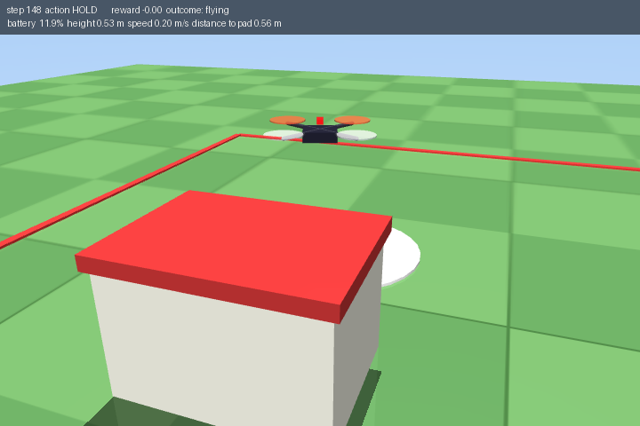
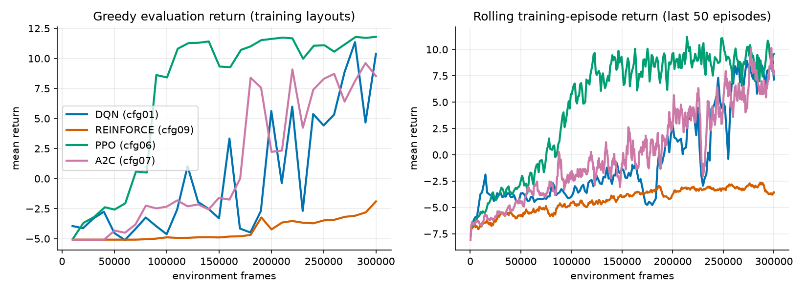
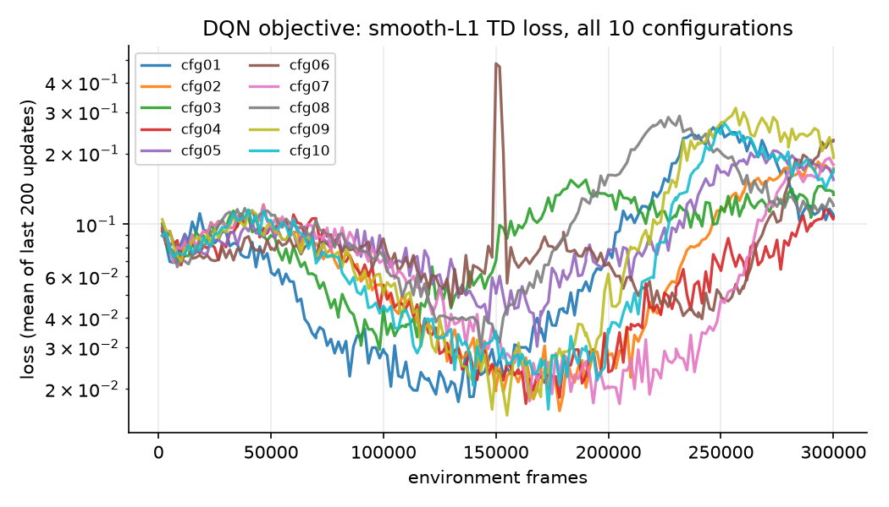
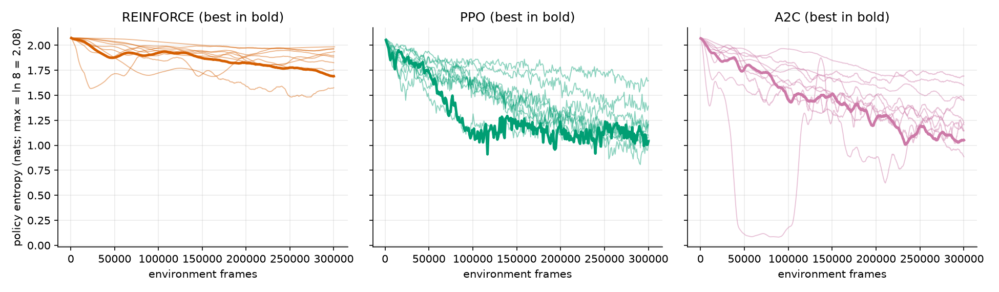
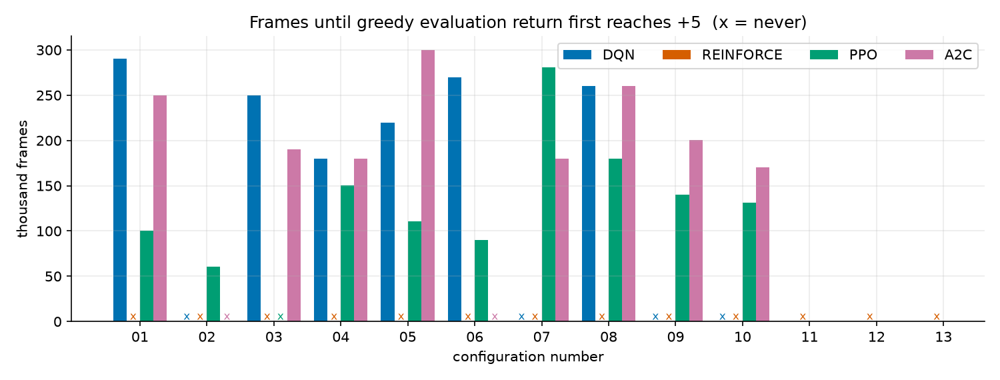
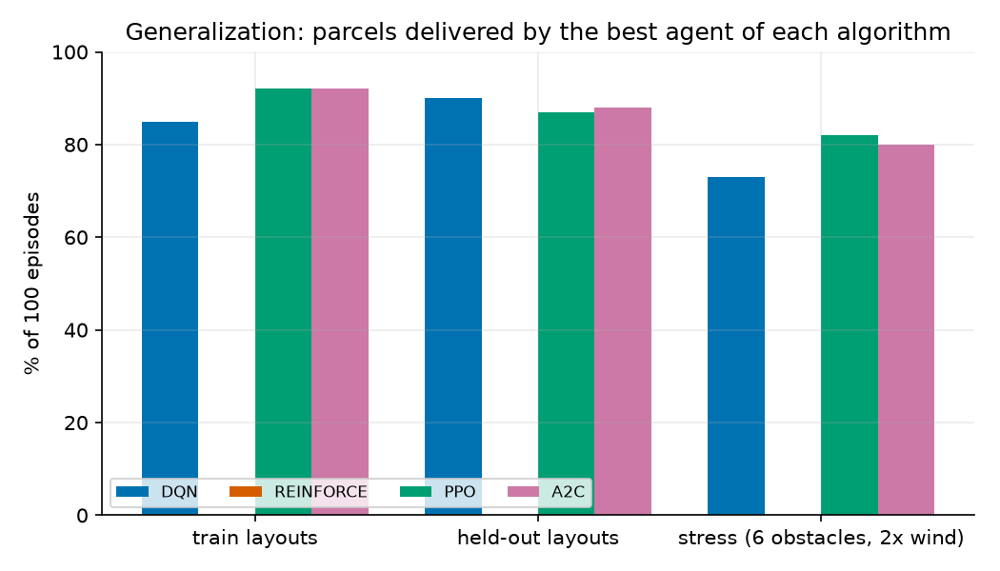

# Medical Delivery Drone: Reinforcement Learning (MuJoCo + TorchRL)

A drone takes off from a hub carrying a medical parcel (blood or vaccines). It must release the parcel
over a rural clinic's landing pad (low, slow and inside the pad) without crashing into obstacles,
leaving the geofence or running out of battery. Rwanda already runs this kind of drone delivery.

Four agents are trained on the same custom Gymnasium environment with TorchRL: **DQN** (value-based) and
**REINFORCE, PPO, A2C** (policy-gradient), each with a hyperparameter sweep of at least 10 configurations.



## Quick start (uv only)

```bash
git clone https://github.com/Manzi453/ivan_manzi_rl_summative- && cd ivan_manzi_rl_summative-
uv sync
uv run main.py                  # results table + replay of the best agent (terminal log, GIF saved to assets/)
uv run mjpython main.py play    # live MuJoCo window of the best agent (macOS needs mjpython; Linux/Windows: uv run main.py play)
uv run pytest                   # 13 environment tests
```

| Command | What it does |
|---|---|
| `uv run main.py play --algo ppo --episodes 3` | replay an agent: `best` (default), `dqn`, `reinforce`, `ppo`, `a2c`, `scripted`, `random` |
| `uv run main.py play --split heldout` | layouts never used in training (`stress` = 6 obstacles + double wind) |
| `uv run main.py play --headless` | no window: renders off-screen and saves a GIF in `assets/` |
| `uv run main.py train --algo dqn --frames 150000 --cfg double_dqn=true` | train one agent, `--cfg KEY=VALUE` overrides a hyperparameter |
| `uv run main.py sweep` | the full sweep: 43 runs (10 configurations per algorithm, 13 for REINFORCE), about 1 hour on 8 cores |
| `uv run main.py analyze` | rebuild `logs/tables/`, `assets/fig_*.png` and `models/best.json` from `logs/` |
| `uv run main.py json` | one episode as JSON lines (state + action per step), see "Integration" |

## Project structure

```
.
├── pyproject.toml          # dependencies (uv)
├── uv.lock
├── README.md
├── main.py                 # entry point: results / play / train / sweep / analyze / json
├── environment/
│   ├── __init__.py         # registers DeliveryDrone-v0
│   ├── custom_env.py       # DeliveryDroneEnv, reward, to_json(), random + scripted reference policies
│   └── rendering.py        # MuJoCo scene (MJCF), off-screen frames and the live window
├── training/
│   ├── __init__.py         # shared helpers, evaluation, logging, SWEEPS (the 40 configurations), analyze()
│   ├── dqn_training.py     # DQN / Double DQN
│   └── pg_training.py      # REINFORCE, PPO, A2C
├── models/
│   ├── dqn/                # DQN checkpoints (dqn_cfgNN.pt)
│   └── pg/                 # REINFORCE / PPO / A2C checkpoints; models/best.json names the best of each
├── logs/                   # curves/*.csv (per run), runs.jsonl (final evaluations), tables/*.md
├── assets/                 # environment preview, demo GIFs, report figures (fig_*.png)
└── tests/                  # pytest suite for the environment
```

## Environment: `DeliveryDrone-v0`

**Mission link.** Medical drone delivery is a real, growing service in Rwanda. Delivering fast matters, but a
rushed drop can destroy the parcel, so speed has to be traded against safety.

**Why RL and not planning or prediction.** Every action changes the state that later decisions depend on, and
the trade-offs pay off late:
- Climbing clears obstacles but burns battery and the release must happen low.
- Speed saves battery per metre but speed cannot be shed instantly (real inertia), so braking has to start
  several steps before the pad.
- Turning costs time, and wind pushes the drone off its line without the agent seeing it directly.
- The only large reward arrives at the end (a soft release over the pad) and one early mistake ends the episode.

Physics is real MuJoCo (gravity, inertia, collisions). The agent picks a high-level command every 0.2 s
(20 physics steps of 0.01 s); a small velocity controller turns the commands into forces. Episodes last at
most 120 steps.

### Actions (`Discrete(8)`)

| id | action | real-world meaning |
|---|---|---|
| 0 | `HOLD` | keep the current commands |
| 1 | `CLIMB` | command +1 m/s vertical speed |
| 2 | `DESCEND` | command -1 m/s vertical speed |
| 3 | `SPEED_UP` | raise the forward speed command by 0.5 m/s (max 2 m/s) |
| 4 | `SLOW_DOWN` | lower the forward speed command by 0.5 m/s |
| 5 | `TURN_LEFT` | command +1.5 rad/s yaw rate |
| 6 | `TURN_RIGHT` | command -1.5 rad/s yaw rate |
| 7 | `RELEASE` | open the parcel hatch (ends the episode). Interlocked: farther than 2 m from the clinic it does nothing and costs -0.05 |

### Observation (`Box(19,)`, float32, clipped to [-1, 1])

Every value is produced by the simulator at the start of each decision step and goes straight into the
policy network (an MLP) as one 19-vector. Sensors with noise are marked.

| idx | feature | meaning | encoding / range | source (simulation rule) |
|---|---|---|---|---|
| 0 | `pad_forward` | clinic pad position ahead of the drone | metres / 10 | GPS-style relative position, drone frame |
| 1 | `pad_left` | clinic pad position to the left | metres / 10 | same |
| 2 | `pad_distance` | straight-line distance to the pad | metres / 10 | same |
| 3 | `pad_bearing` | angle to the pad | radians / pi | same |
| 4 | `height` | height above ground | metres / 4.5 (the ceiling) | MuJoCo drone position |
| 5 | `v_forward` | forward velocity | m/s / 2.5 | MuJoCo drone velocity, drone frame |
| 6 | `v_lateral` | sideways velocity | m/s / 2.5 | same |
| 7 | `v_vertical` | vertical velocity | m/s / 1.5 | same |
| 8 | `speed_command` | current forward-speed command | m/s / 2 | internal controller state |
| 9 | `battery` | charge left | % / 100 | energy model: 3 + 2.5 v^2 + 4 max(vz, 0) per second |
| 10-14 | `range_-90 ... range_+90` | distance to the nearest obstacle in 5 directions, horizontal plane | metres / 4 (max reach 4 m); **noise sigma 0.02 m** | MuJoCo ray casts, solid world only |
| 15 | `range_down` | distance to the ground | metres / 4 | MuJoCo ray cast |
| 16-17 | `wind_forward`, `wind_left` | wind disturbance in the drone frame | m/s^2 / 3; **noise sigma 0.1** | random per episode, noisy anemometer |
| 18 | `steps_left` | remaining decision steps | 1 - step / 120 | episode clock |

All values refresh every decision step (every 0.2 s of simulated time). The wind force and the exact
obstacle positions are not observed directly: the agent infers them from the range-finders and from how its
velocity responds.

### Start state

The drone is on the hub at 0.5 m height with a random heading, zero speed command, 100% battery and the
parcel attached. The layout (hub, pad and 4 obstacles) comes from a layout id, and the wind has a random
direction and strength. The first obstacle is always placed near the straight line between hub and pad, so
flying straight at the pad is never safe.

### Terminal conditions and rewards

| Outcome | How it ends | Reward |
|---|---|---|
| `delivered` | released inside the pad (0.6 m), below 1 m and slower than 0.6 m/s | +10, plus up to +2 for battery left |
| `damaged` | released over the pad but too high or too fast | +2 |
| `parcel_lost` | released outside the pad | -5 |
| `crashed` | contact with an obstacle or the ground | -5 |
| `battery_empty` | battery reaches 0 | -5 |
| `left_geofence` | beyond 6.5 m from the centre or above 4.5 m | -5 |
| `timeout` | 120 steps used | -2 |

During the flight the reward is -0.02 per step, plus **potential-based shaping** (progress toward the pad
0.5 per metre, facing the pad, and being low and slow within 3 m of it). Potential-based shaping does not
change which policy is optimal (Ng et al., 1999) but gives the agent a learning signal long before the
first delivery.

**Layout splits:** `train` (400 layouts, 4 obstacles, wind up to 1.5 m/s^2), `heldout` (100 layouts never
seen in training) and `stress` (100 layouts, 6 obstacles, wind up to 3 m/s^2).

### Integration (API / serialization path)

`DeliveryDroneEnv.to_json()` serialises the whole world (drone pose, speed, battery, hub, pad, obstacles,
wind, geofence) as a JSON-ready dict, which is what a web or mobile dashboard would draw. `uv run main.py
json` prints one episode with the best agent as JSON lines: `{"event": "step", "action": "SLOW_DOWN",
"reward": ..., "state": {...}}`. A front end sends the 19-value observation to the policy and receives one
of the 8 action names back.

## Algorithms and fair comparison

All four use TorchRL on the same environment, the same 300,000-frame budget per sweep run and the same
evaluation protocol (greedy policy; 100 episodes on each of the three splits at the end of every run, 30
training-layout episodes every 10,000 frames during training).

- **DQN**: `QValueActor`, `EGreedyModule`, replay buffer, `DQNLoss` (smooth-L1), soft or hard target update, optional Double DQN.
- **REINFORCE**: `ProbabilisticActor` (categorical), Monte-Carlo reward-to-go with a batch-mean, learned-value or no baseline.
- **PPO**: `ClipPPOLoss` with GAE.
- **A2C**: `A2CLoss` with GAE.

## Results

Sweep: 10 configurations for DQN, PPO and A2C and 13 for REINFORCE (3 added after the first 10 all failed), all with
300,000 frames and seed 0. Full tables with every hyperparameter: [`logs/tables/`](logs/tables) (`sweep_dqn.md`,
`sweep_reinforce.md`, `sweep_ppo.md`, `sweep_a2c.md`, `sweep_all.csv`). The best run of each algorithm is picked by
its greedy return on the training layouts and recorded in `models/best.json`.

| Algorithm | Best run | Train return | Delivered: train / held-out / stress | Crashed (train) |
|---|---|---|---|---|
| PPO | cfg06 | +11.25 | 87% / 84% / 70% | 11% |
| DQN | cfg01 | +9.87 | 77% / 79% / 51% | 19% |
| A2C | cfg07 | +9.31 | 77% / 72% / 51% | 15% |
| REINFORCE | cfg13 | -1.59 | 0% / 0% / 0% | 1% |

Delivered = share of 100 greedy episodes that ended with a soft release over the pad. Held-out and stress layouts were never used for training or model selection.







### What the sweeps show

- **PPO is the most robust and fastest.** 9 of 10 configurations deliver 77-87% of parcels, and the best ones reach a
  greedy return of +5 after only 81,000 to 90,000 frames (DQN and A2C need about 180,000). The one failure is an entropy
  bonus of 0.05 (cfg07), which keeps the policy close to random. Clip range (0.1 to 0.3) and batch size barely matter; a lower
  learning rate (1e-4) is slower and weaker.
- **DQN learns, but is unstable.** Its evaluation return jumps between checkpoints (see the reward figure) and it is sensitive
  to three settings: learning rate 3e-4 (1% delivered), a hard target update every 500 steps (14%) and a 100k replay buffer (3%).
  Double DQN configurations (cfg02, cfg03, cfg05) generalize better to held-out and stress layouts (up to 86% and 67%) than the plain
  DQN with the best training score (cfg01: 79% and 51%).
- **A2C works but is sensitive to step size and critic weight.** lr 3e-4 never learned; lr 3e-3 and critic coefficient 1.0 were
  worse than the default; removing the entropy bonus gave a similar result (77% vs 79%), while 0.05 slowed learning (63%).
- **REINFORCE failed in all 13 configurations** (0% delivered, returns between -5.0 and -1.6). Its policy entropy stays high
  (mostly above 1.5 of a maximum of 2.08, figure above), which means it barely improved. It takes one gradient step per batch, so it makes
  far fewer updates than PPO within the same frame budget, and with one long episode per update the Monte-Carlo gradient is very noisy
  while delivery is rare early on. Value baselines and smaller batches changed the return only slightly (best: cfg13, -1.59). I did not find a
  bug in the implementation, but I cannot rule one out.
- **Generalization.** Held-out layouts (same difficulty, new geometry) cost the good agents little (PPO 84%, DQN 79%).
  The stress layouts (6 obstacles, double wind) are harder: PPO keeps 70% but DQN and A2C fall to 51%.
- **Limits.** Each configuration was run with a single seed, so small differences (a few percentage points) are not
  reliable: in earlier 500,000-frame runs the same DQN configuration gave 0%, 56% and 76% on three seeds.

### Reproduce

```bash
uv run main.py sweep      # 43 runs, about 1 hour on 8 cores; ends by calling analyze
uv run main.py analyze    # only rebuild tables, figures and models/best.json
```

